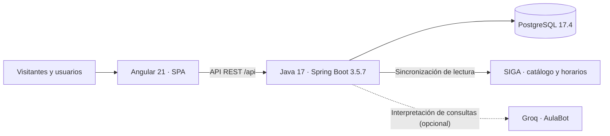

<div align="center">

# 🏫 AulaSmart

### Gestión de aulas, disponibilidad académica y solicitudes de reserva

Aplicación web desarrollada para facilitar la consulta de espacios académicos y la gestión de solicitudes de aulas en la **Unidad Central del Valle del Cauca (UCEVA)**.

[**🌐 Explorar la aplicación**](https://stevendz.tech/aulasmart/) · [**🏗️ Arquitectura**](docs/arquitectura.md) · [**📚 Documentación técnica**](docs/README.md)


[](https://github.com/stevendz2002/aulasmart-classroom-management/actions/workflows/deploy-frontend.yml)

</div>

## 📌 ¿Qué es AulaSmart?

AulaSmart centraliza la **consulta de aulas**, la **visualización de disponibilidad por fecha y horario** y el **flujo de solicitudes de reserva**. Combina las solicitudes registradas en la aplicación con el catálogo y la ocupación académica consultados desde **SIGA**, el sistema de información de la universidad.

El proyecto aborda un problema real: consultar espacios disponibles sin perder de vista las clases programadas, gestionar solicitudes según el rol del usuario y evitar que se aprueben reservas locales que se solapen.

> [!IMPORTANT]
> Una solicitud **aprobada en AulaSmart** no equivale a una reserva institucional confirmada en SIGA. La integración actual **consulta y sincroniza** información académica; no registra reservas directamente en SIGA.

## ✨ Funcionalidades

- **Consulta pública:** catálogo, dashboard y disponibilidad de aulas, sin iniciar sesión para las vistas habilitadas.
- **Búsqueda de espacios:** consulta por edificio, tipo, capacidad y franja horaria.
- **Disponibilidad verificable:** combina horarios académicos de SIGA y solicitudes locales aprobadas; evita informar un aula como libre cuando los datos carecen de cobertura o vigencia suficiente.
- **Solicitudes de reserva:** registro por docentes y revisión (aprobación o rechazo) por personal autorizado.
- **Gestión administrativa:** administración de aulas, usuarios y sincronizaciones según permisos.
- **AulaBot:** asistente conversacional para orientar búsquedas de aulas en lenguaje natural y continuar hacia la consulta o el formulario correspondiente. Utiliza Groq cuando la integración está habilitada; no crea ni aprueba reservas automáticamente.
- **Autenticación y autorización:** JWT Bearer, renovación de sesión mediante cookie HttpOnly y control de acceso por rol.
- **Interfaz adaptable:** SPA Angular con diseño responsivo, modo claro y modo oscuro.

### Roles y permisos

| Rol | Capacidades principales |
| --- | --- |
| Visitante | Consultar las vistas públicas y utilizar las funciones públicas de AulaBot |
| Estudiante | Consultar el catálogo y la disponibilidad |
| Docente | Consultar aulas y crear solicitudes |
| Administrativo | Revisar solicitudes y gestionar aulas |
| Administrador | Administrar usuarios y acceder a funciones de gestión autorizadas |

## 🧱 Arquitectura

Se utiliza un **monolito modular** en el backend y una SPA Angular en el frontend. Los módulos mantienen responsabilidades separadas y siguen una organización inspirada en **Clean Architecture**: `domain`, `application`, `infrastructure` y `presentation`.



**Módulos principales del backend**

| Módulo | Responsabilidad |
| --- | --- |
| `users` | Usuarios, roles, autenticación y permisos |
| `aulas` | Catálogo, filtros y disponibilidad |
| `solicitudes` | Solicitudes, revisiones y reglas de solapamiento |
| `integrations.siga` | Sincronización del catálogo y los eventos académicos |
| `aulabot` / integración de IA | Interpretación conversacional y acceso a consultas reales |
| Persistencia compartida | Spring Data JPA y migraciones Flyway |

### Decisiones técnicas relevantes

- **Integridad en base de datos:** PostgreSQL usa una restricción `EXCLUDE` para evitar solicitudes **aprobadas** con franjas superpuestas en una misma aula.
- **Concurrencia:** las revisiones de solicitudes incorporan control de versiones y manejo de conflictos.
- **Sincronización responsable:** si SIGA falla o sus datos no cubren el intervalo solicitado, la aplicación muestra un estado no verificable en lugar de asumir disponibilidad.
- **Separación de responsabilidades:** AulaBot interpreta consultas, mientras que el backend valida filtros, permisos y disponibilidad mediante los casos de uso existentes.
- **Migraciones versionadas:** Flyway administra los cambios de esquema de la base de datos.

Más información en [arquitectura y decisiones](docs/arquitectura.md) y [sincronización de SIGA](docs/sincronizacion-siga.md).

## 🛠️ Tecnologías

| Capa | Herramientas |
| --- | --- |
| Backend | Java 17, Spring Boot 3.5.7, Spring Web MVC, Spring Security, Spring Data JPA, Hibernate |
| Frontend | Angular 21.2, TypeScript, RxJS, Vitest |
| Base de datos | PostgreSQL 17.4, Flyway |
| Seguridad | JWT, BCrypt, cookies HttpOnly, autorización por roles |
| Pruebas | Maven, JUnit / pruebas de integración, Vitest |
| Infraestructura | Docker Compose, Nginx, Oracle Cloud |
| CI/CD | GitHub Actions, GitHub Pages |
| Asistente | Integración opcional con Groq |

## 📁 Estructura del repositorio

```text
aulasmart-classroom-management/
├── aulasmart-backend/       # API Spring Boot
├── aulasmart-frontend/      # SPA Angular
├── database/                # Scripts y validaciones SQL
├── docs/                    # Arquitectura, fases y despliegue
├── deploy/                  # Configuración de despliegue
├── .github/workflows/       # Automatizaciones
├── compose.yaml             # Entorno local
└── .env.example             # Ejemplo de configuración
```

## 🚀 Ejecutar en local

**Requisitos:** Git, Docker y Docker Compose. Para ejecutar los componentes sin Docker también se necesitan Java 17 y Node.js compatible con Angular 21.

### Opción recomendada: Docker Compose

1. Clona el repositorio:

   ```bash
   git clone https://github.com/stevendz2002/aulasmart-classroom-management.git
   cd aulasmart-classroom-management
   ```

2. Crea un archivo `.env` a partir de `.env.example`. En PowerShell:

   ```powershell
   Copy-Item .env.example .env
   ```

   En Bash:

   ```bash
   cp .env.example .env
   ```

3. Configura las variables requeridas. En particular, `POSTGRES_PASSWORD` y `DB_PASSWORD` deben coincidir; define también el secreto JWT según el archivo de ejemplo. No subas `.env` al repositorio. **Groq es opcional** para la ejecución local.

4. Levanta los servicios:

   ```bash
   docker compose up -d --build
   ```

| Servicio | Dirección local |
| --- | --- |
| Frontend | http://localhost:4200 |
| API | http://localhost:8080/api |
| Health check | http://localhost:8080/actuator/health |
| PostgreSQL | `localhost:5433` |

Para revisar registros y detener el entorno:

```bash
docker compose logs -f backend
docker compose down
```

### Desarrollo por componentes

Con la base PostgreSQL levantada y las variables de entorno configuradas:

```bash
docker compose up -d db

# Terminal 1: backend
cd aulasmart-backend
./mvnw spring-boot:run

# Terminal 2: frontend (desde la raíz del repositorio)
cd aulasmart-frontend
npm ci
npm start
```

> En Windows, utiliza `mvnw.cmd` en lugar de `./mvnw`. Las migraciones Flyway se aplican durante el arranque del backend.

## 🧪 Pruebas

**Backend**, desde `aulasmart-backend/`:

```bash
./mvnw test
```

**Frontend**, desde `aulasmart-frontend/`:

```bash
npm ci
npm test -- --watch=false
```

Las pruebas y validaciones documentadas pueden consultarse en [documentación técnica](docs/README.md). El workflow de frontend ejecuta pruebas y compilación antes de publicar en GitHub Pages.

## 🔌 API REST: ejemplos de rutas

| Método | Endpoint | Propósito |
| --- | --- | --- |
| `GET` | `/api/aulas` | Listar aulas |
| `GET` | `/api/aulas/disponibles` | Consultar disponibilidad en una franja |
| `GET` | `/api/aulas/{idAula}` | Obtener el detalle de un aula |
| `GET / POST` | `/api/solicitudes` | Consultar o registrar solicitudes según permisos |
| `POST` | `/api/solicitudes/{idSolicitud}/revision` | Aprobar o rechazar una solicitud |
| `GET / POST` | `/api/usuarios` | Directorio y creación de usuarios para administradores |
| `GET` | `/api/usuarios/whoami` | Consultar el perfil de sesión |
| `POST` | `/api/sincronizaciones` | Iniciar la sincronización de aulas o eventos |

El acceso a cada ruta depende de sus reglas de seguridad; las operaciones de gestión requieren autenticación y permisos.

## ☁️ Despliegue

El frontend se compila y publica en **GitHub Pages** mediante **GitHub Actions**. La aplicación se expone en el dominio del proyecto, mientras que **Nginx y Oracle Cloud** proporcionan acceso a la API Spring Boot y a PostgreSQL.

- **Aplicación:** [stevendz.tech/aulasmart](https://stevendz.tech/aulasmart/)
- **Workflow:** [deploy-frontend.yml](.github/workflows/deploy-frontend.yml)
- **Documentación:** [despliegue e infraestructura](docs/despliegue.md)

> La consulta de disponibilidad depende de la sincronización con SIGA. Si la fuente externa es inaccesible o los datos están desactualizados, AulaSmart debe indicar que no puede verificar la disponibilidad.

## 📚 Documentación adicional

- [Arquitectura y decisiones](docs/arquitectura.md)
- [Documentación técnica y validaciones](docs/README.md)
- [Sincronización con SIGA](docs/sincronizacion-siga.md)
- [Plan de desarrollo](docs/plan-maestro.md)
- [Guía de continuidad para desarrollo](AGENTS.md)

## 👨‍💻 Autor

**Jhon Edward Steven Loaiza Díaz**  
Estudiante de Ingeniería de Sistemas · Unidad Central del Valle del Cauca (UCEVA), Tuluá, Colombia.

[GitHub](https://github.com/stevendz2002)

---

<sub>Proyecto académico de desarrollo de software. AulaSmart es una herramienta de consulta y gestión local de solicitudes; no sustituye los procesos oficiales de asignación de aulas de la universidad.</sub>
