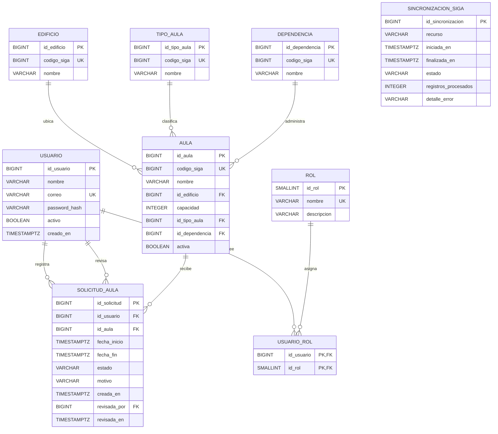

# Entregable 1: modelo entidad-relación

## 1. Alcance y decisiones

El modelo cubre cuentas y roles propios de AulaSmart, catálogos sincronizados desde SIGA, aulas, solicitudes de reserva internas y control de sincronización. No incluye reservas oficiales de SIGA ni equipamiento, porque no pertenecen al alcance verificado. AulaSmart es una web de reservas de aulas: la tabla de ocupaciones académicas importadas (`horario_academico`) se eliminó en la migración V3 de la fase de reservas; las ocupaciones provienen únicamente de las solicitudes APROBADAS dentro de AulaSmart.

`CONVERSACION` y `MENSAJE` no se incluyen: la persistencia del historial de AulaBot no es necesaria para las consultas ni para los cinco entregables. Podrán agregarse después si se convierte en un requisito explícito.

Los códigos `codigo_siga` conservan los identificadores externos confirmados en aulas, edificios, tipos y dependencias. Las claves `id_*` son internas y evitan acoplar las relaciones locales a códigos externos.

`aula.activa` es un atributo **local**, no un campo observado en SIGA. Las fechas de las solicitudes usan `TIMESTAMPTZ` para conservar instantes completos y evitar perder horas o zona horaria.

## 2. Diagrama ER único

`SINCRONIZACION_SIGA` es una entidad de control independiente: registra ejecuciones de sincronización y no representa una relación de negocio con cada aula. El campo `recurso` solo admite `AULAS` desde la migración V3.

## 3. Cardinalidades y reglas

- Un usuario puede tener varios roles y un rol puede pertenecer a varios usuarios. La clave compuesta de `USUARIO_ROL` impide asignaciones duplicadas.
- Cada aula pertenece exactamente a un edificio, un tipo y una dependencia; cada catálogo puede clasificar muchas aulas.
- Un aula puede tener muchas solicitudes. Cada solicitud es independiente: no proviene de importaciones ni es una reserva oficial de SIGA.
- Una solicitud tiene un docente solicitante. Si está aprobada o rechazada, debe registrar revisor y fecha; si está pendiente, ambos deben ser nulos.
- Los correos se consideran únicos sin distinguir mayúsculas de minúsculas. Las contraseñas se almacenan como hash, nunca como texto plano.
- `capacidad > 0`, `fecha_fin > fecha_inicio` y los estados permitidos se validan también en la base de datos.

## 4. Solapamientos y disponibilidad

Dos intervalos `[inicio, fin)` se solapan cuando:

`inicio_existente < fin_consultado AND fin_existente > inicio_consultado`.

El esquema usa una restricción de exclusión PostgreSQL para impedir dos solicitudes **aprobadas** solapadas en la misma aula. La aprobación re-verifica en la misma transacción que no exista una reserva APROBADA solapada; la restricción de exclusión es la garantía final de la base.

Para responder disponibilidad, el backend debe exigir catálogo de aulas sincronizado y vigente (antigüedad máxima de 24 horas), aulas activas y ausencia de solapamientos con solicitudes APROBADAS. Si faltan datos o la sincronización no está vigente, debe responder que no puede confirmarse la disponibilidad, no afirmar que el aula está libre.

La aprobación en AulaSmart no registra ni implica una reserva oficial en SIGA.

## 5. Implementación

- Esquema reproducible: `aulasmart-backend/src/main/resources/db/migration/V1__initial_schema.sql` con ajustes de secuencias (V2) y consolidación de reservas (V3, eliminación de `horario_academico` y del recurso EVENTOS), disponibles también en el contenedor vía `compose.yaml` para su aplicación directa con `psql`.
- Datos exclusivamente sintéticos: `database/seeds/001_datos_prueba.sql`.
- Verificación de relaciones y reglas: `database/validation/001_validaciones.sql`.
- Evidencia de campos externos y aspectos pendientes: `docs/evidencias/01-fuentes-siga.md`.
