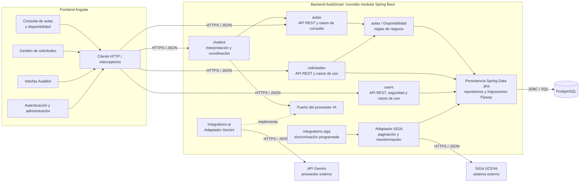

# Entregable 3: diagrama de componentes

## Propósito

El diagrama representa componentes de software y sus dependencias, no clases ni servidores. Todos los módulos del recuadro Backend pertenecen a **un único despliegue Spring Boot** y comparten una base PostgreSQL, sin convertirse en microservicios.

## Responsabilidades y límites

- **users:** cuentas, roles, autenticación y autorización. Spring Security comprueba permisos en el backend; Angular solo adapta la experiencia visual.
- **aulas:** catálogos, consulta con filtros y regla de disponibilidad sobre reservas aprobadas. Publica un servicio de aplicación para que otros módulos no reimplementen la regla.
- **solicitudes:** creación, consulta, aprobación y rechazo de reservas de aulas. Verifica el catálogo bajo puertos de `aulas` y ejecuta la operación transaccionalmente.
- **chatbot:** interpreta la intención, solicita datos estructurados a `aulas` y redacta la respuesta con esos resultados. No calcula disponibilidad ni concede permisos.
- **integrations.siga:** cliente HTTP, control de reintentos acotados, transformación, upsert y registro de sincronización. Aísla los nombres y particularidades de SIGA.
- **integrations.ai:** adapta la API del proveedor. La clave se configura fuera del código y el módulo no recibe autoridad para decidir reglas institucionales.
- **persistencia:** cada módulo es dueño de sus repositorios. Flyway versiona un único esquema; no se crean bases independientes por módulo.
- **shared:** se limitará a errores, tipos o configuraciones realmente transversales. No se prevé un componente genérico para evitar duplicación sin justificación.

## Coherencia con Clean Architecture

Los controladores pertenecen a `presentation`; los casos de uso a `application`; las reglas, entidades y puertos a `domain`; y JPA, SIGA y Gemini a `infrastructure`. Las flechas de negocio apuntan a servicios y puertos, no a controladores ni clientes externos.

Para evitar un ciclo entre `aulas` y `solicitudes`, la regla de disponibilidad consume un puerto de ocupaciones internas. `solicitudes` aporta el adaptador que expone sus solicitudes aprobadas y, a su vez, invoca el servicio público de disponibilidad al aprobar. La inyección de dependencias conecta estas piezas sin que el dominio conozca JPA.

## Patrones justificados

- **Adapter:** `SigaAdapter` y el adaptador de Gemini traducen formatos externos a contratos internos. Evitan que cambios de una API se propaguen al dominio.
- **Repository:** los repositorios encapsulan consultas y persistencia; los casos de uso no construyen SQL ni dependen de controladores.
- **Strategy:** no se introduce inicialmente. Solo tendría sentido si se verifican múltiples algoritmos de disponibilidad realmente intercambiables.
- **Factory Method:** tampoco se introduce de forma preventiva; la configuración de beans de Spring es suficiente para las implementaciones previstas.

Este diagrama es una propuesta de diseño coherente con la base ya montada, no una afirmación de que los módulos Java estén implementados.
