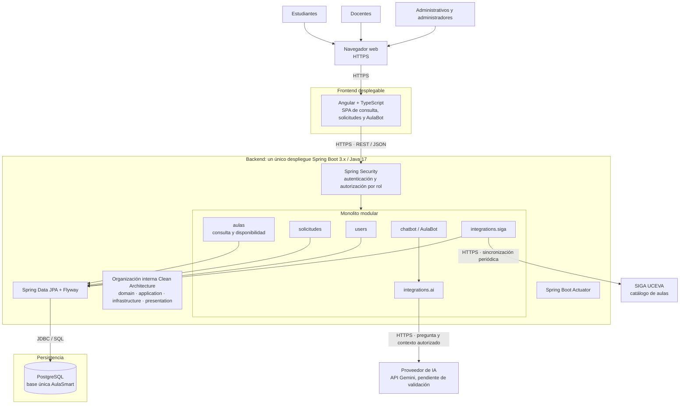

# Entregable 4: arquitectura general del sistema

## Vista general

A diferencia del diagrama de componentes, esta vista muestra actores, canales, unidades desplegables, almacenamiento y sistemas externos. El backend es una sola aplicación Spring Boot organizada internamente como monolito modular.

## Comunicaciones principales

1. Los usuarios acceden desde el navegador a Angular. No existe acceso directo del frontend a PostgreSQL, SIGA o Gemini.
2. Angular consume la API REST del backend. La autenticación y los permisos se verifican en Spring Security y en los casos de uso correspondientes.
3. JPA ejecuta las consultas sobre PostgreSQL. La disponibilidad se calcula en `aulas` con las solicitudes aprobadas y el estado de sincronización.
4. Un proceso programado dentro del mismo backend sincroniza SIGA. La frecuencia definitiva queda pendiente de observación del servicio y validación institucional.
5. AulaBot utiliza el proveedor de IA para interpretar o redactar, pero obtiene los datos desde los casos de uso del backend. Una respuesta de IA no basta para afirmar disponibilidad.
6. Actuator expone únicamente los endpoints operativos que se configuren y protejan; no implica una plataforma adicional de observabilidad.

## Decisiones de despliegue y seguridad

- Angular y Spring Boot son unidades desplegables separadas; los módulos Java no lo son.
- PostgreSQL conserva datos institucionales sincronizados y datos propios de AulaSmart en un esquema común con dueños modulares claros.
- Las credenciales de PostgreSQL y Gemini se suministran como variables de entorno o secretos de ejecución, nunca en Git.
- Docker es una opción para reproducir el entorno. El entregable de base de datos ya usa un contenedor; no se afirma que exista todavía un despliegue completo.
- No se incorporan colas, cachés distribuidos, API gateways ni bases por módulo porque no hay una necesidad demostrada.

## Pendientes explícitos

- Comprobar disponibilidad, límites y condiciones de uso de Gemini.
- Definir la frecuencia de sincronización y el umbral de vigencia permitido.
- Implementar y probar el frontend y el backend representados; actualmente solo la base de datos está montada.
